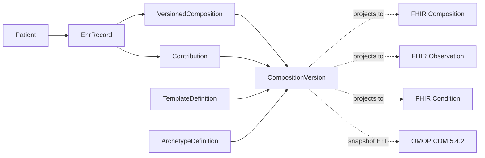

# soap-ehr — guia de desenvolvimento e operação

> Referência detalhada (variáveis de ambiente, Docker, migração V1→V2, importação FHIR, Prisma). O resumo do projeto está no [README](../README.md). Conteúdo em inglês.

`soap-ehr` is a compact clinical-record application for studying three complementary health-data standards:

- openEHR-inspired archetypes, operational templates, compositions and versioning are the canonical clinical persistence model;
- FHIR remains the interoperability API and import/export surface;
- OMOP CDM 5.4.2 is a derived, read-only PostgreSQL analytical projection.

The application is intentionally narrow:

- token-based authentication
- patient registry and editing
- agenda with appointment-based attendance entry
- SOAP and narrative note registration
- FHIR-oriented API
- FHIR Bundle import
- Swagger/OpenAPI docs
- Docker-based execution

The implementation stays as a single full-stack monolith and follows `YAGNI`, `DRY`, and `KISS`.

## Stack and Architecture

- React Router v7 in framework mode
- React + TypeScript
- Node.js
- Prisma ORM
- PostgreSQL for the canonical EHR and OMOP analytics
- Tailwind CSS
- OpenAPI + Swagger UI
- Docker Compose

Operational rules in this codebase:

- frontend and backend run in the same Node application
- web routes and API routes are served by the same runtime
- the default local V2 stack uses the PostgreSQL container from Docker Compose
- schema changes are versioned through Prisma migrations in `prisma/migrations/`
- Prisma Client remains the typed access layer used by the application
- operational data such as users, patients, appointments and drafts remains relational
- clinical content is stored only as versioned compositions validated against a template
- the API layer projects canonical compositions to FHIR resources
- `prisma/migrations/` contains the canonical PostgreSQL schema migrations

## Data Architecture



## Modelo informacional openEHR (resumo)

> [!NOTE]
> ### 🧩 Arquétipos e templates usados no registro clínico
> O `soap-ehr` usa um **núcleo inspirado no openEHR**: a `COMPOSITION` é o
> documento clínico versionado; os arquétipos definem o tipo de cada parte; e o
> template decide quais partes são obrigatórias em cada formulário. Este não é
> um servidor openEHR de conformidade completa: não há processamento de
> ADL/OPT, AQL ou todo o Reference Model.
>
> ```mermaid
> flowchart TD
>   C["COMPOSITION<br/>openEHR-EHR-COMPOSITION.encounter.v1<br/><i>consulta / documento clínico</i>"]
>   C --> S["SOAP template<br/>soap-ehr.template.encounter-soap.v1"]
>   C --> N["Narrative template<br/>soap-ehr.template.encounter-narrative.v1"]
>   S --> S1["at0001 · Subjective<br/>OBSERVATION · story.v1"]
>   S --> S2["at0002 · Objective<br/>OBSERVATION · clinical_exam.v1"]
>   S --> S3["at0003 · Assessment<br/>EVALUATION · clinical_assessment.v1"]
>   S --> S4["at0004 · Plan<br/>EVALUATION · care_plan.v1"]
>   N --> N1["Seções repetíveis<br/>EVALUATION · clinical_narrative.v1"]
> ```
>
> | Arquétipo | Tipo RM | Onde é usado | Conteúdo simplificado |
> | --- | --- | --- | --- |
> | `openEHR-EHR-COMPOSITION.encounter.v1` | `COMPOSITION` | Raiz dos dois templates | Uma consulta/documento clínico, com autor, data, contexto e seções. |
> | `openEHR-EHR-OBSERVATION.story.v1` | `OBSERVATION` | SOAP → Subjective (`at0001`) | Relato e história informados pelo paciente. |
> | `openEHR-EHR-OBSERVATION.clinical_exam.v1` | `OBSERVATION` | SOAP → Objective (`at0002`) | Achados objetivos do exame clínico. |
> | `openEHR-EHR-EVALUATION.clinical_assessment.v1` | `EVALUATION` | SOAP → Assessment (`at0003`) | Avaliação/interpretação clínica. |
> | `openEHR-EHR-EVALUATION.care_plan.v1` | `EVALUATION` | SOAP → Plan (`at0004`) | Plano de cuidado em texto livre: condutas, orientações, prescrições, retornos ou solicitações. |
> | `openEHR-EHR-EVALUATION.clinical_narrative.v1` | `EVALUATION` | Nota narrativa → seções repetíveis | Texto clínico livre organizado em uma ou mais seções. |
>
> **Como ler a estrutura:** `COMPOSITION` contém `SECTION`; cada `SECTION`
> contém uma `OBSERVATION` ou `EVALUATION`; o texto é armazenado em um
> `ITEM_TREE` com um `ELEMENT` (`DV_TEXT`). Nas `OBSERVATION`, o texto fica em
> `HISTORY → POINT_EVENT → ITEM_TREE`; nas `EVALUATION`, fica diretamente em
> `ITEM_TREE`. A composição validada é salva como uma versão imutável e é a fonte
> canônica para as projeções FHIR e OMOP.

## Local Run

1. Install dependencies.

```bash
pnpm install
```

2. Create environment variables.

```bash
cp .env.example .env
```

3. Generate Prisma Client.

```bash
pnpm prisma:generate
```

4. Apply migrations to the database pointed to by `DATABASE_URL`.

```bash
pnpm prisma:migrate:deploy
```

5. Start the application.

```bash
pnpm dev
```

## Docker Run

Use Docker Compose for the PostgreSQL V2 database and the Node monolith:

```bash
docker compose -f compose.yml -f compose.dev.yml up --build
```

The default stack contains the application and PostgreSQL. To install the
optional OMOP CDM schema:

```bash
docker compose -f compose.yml -f compose.dev.yml --profile omop up -d
```

`soap-ehr-db` is the PostgreSQL 17 database `soap_ehr`, containing the canonical
runtime in `public`, OMOP CDM in `omop`, and ETL metadata in `soap_ehr_etl`.

The `soap-ehr` service applies only the PostgreSQL V2 Prisma migrations. The
`soap-ehr-omop-init` service, under the `omop` profile, installs the pinned
39-table CDM 5.4.2 schema in the same database; see the
[OMOP runbook](omop.md). The application never requires it to start.

If ports `3000` or `5438` are already in use, override them with
`APP_PORT` or `DB_PORT` respectively.

To test S3-compatible attachment storage locally, enable the RustFS override first:

```bash
cp compose.override.yml.bak compose.override.yml
docker compose -f compose.yml -f compose.dev.yml up --build
```

## Environment Variables

- `DATABASE_URL`: V2 runtime connection string used by Prisma Client
- `OMOP_DATABASE_URL`: ETL connection to the same PostgreSQL database; OMOP uses separate schemas
- `APP_PORT`: host port published for the web app in Docker Compose
- `APP_URL`: external base URL used in generated docs and examples
- `DB_PORT`: host port published for PostgreSQL, default `5438`
- `SOAP_EHR_DB_NAME`: V2 database name, default `soap_ehr`
- `DB_USER`, `DB_PASS`: PostgreSQL V2 credentials
- `PORT`: Node application port
- `COOKIE_NAME`: auth cookie name for web login
- `API_DRY_RUN`: when `true`, FHIR API writes are stored in process memory instead of Prisma; restarting the app/container clears the dry-run data
- `PATIENT_SEARCH_MAX_EDITS`: tolerance of the approximate patient-name search, 0 to 3, default `2`: wrong letters accepted in a word of 5+ letters (4-letter words accept at most 1, shorter ones none) and letters a stretch inside a word may leave over (`ilva` finds `Silva`; `ana` does not find `Mariana`)
- `MEUEXAME_API_BASE_URL`: base URL that enables the MeuExame attachment plugin
- `DOCS_APP_BASE_URL`: browser-accessible base URL that enables the Docs document-generation integration
- `DOCS_WEBHOOK_BASE_URL`: optional server-to-server base URL sent to Docs as the issued-document webhook target; defaults to `DOCS_APP_BASE_URL`
- `PLUGIN_SECRET_ENCRYPTION_KEY`: base64-encoded 32-byte key used to encrypt per-user plugin tokens

Each user configures their MeuExame token in `/settings`. The token needs
`exams:write` and `exams:read`.

Each user configures their Docs API key in `/settings`. The same API key is used
to derive the AES-256-GCM key for encrypted URL parameter values sent to the
Docs app. In local Docker setups where the browser opens this app through
`http://localhost:<port>` but the Docs API posts webhooks from inside a
container, set `DOCS_WEBHOOK_BASE_URL` to an address reachable by that container,
for example `http://host.docker.internal:<port>`.

## Prisma Usage

This project uses Prisma ORM for schema versioning and Prisma Client for reads, writes, and typing.

Practical rule:

- run `pnpm prisma:generate` after schema changes
- create new schema changes with `pnpm prisma:migrate:dev --name <migration-name>`
- apply committed migrations with `pnpm prisma:migrate:deploy`

## Create a User and Token

Create the first clinical user and token with the CLI:

```bash
pnpm create:user
```

The command prompts for full name, CRM, and CRM UF when they are not passed as flags. You can also provide them explicitly:

```bash
pnpm create:user -- --fullName "Dra. Ana Silva" --crm "12345" --crmUf "BA"
```

The token is shown once at creation time. Store it safely and use the same token for:

- login in the web interface
- `Authorization: Bearer <token>` on API requests

## Access Points

With the default local configuration:

- web app: `http://localhost:3000/login`
- Swagger UI: `http://localhost:3000/docs`
- OpenAPI JSON: `http://localhost:3000/openapi.json`
- FHIR metadata: `http://localhost:3000/fhir/metadata`
- FHIR patient search: `http://localhost:3000/fhir/Patient`
- FHIR Bundle import: `POST http://localhost:3000/fhir`

## Import Notes

The FHIR import endpoint accepts a focused subset of `Bundle` payloads for:

- `Patient`
- `Appointment`
- `Composition` for either SOAP or narrative clinical notes
- referenced `Encounter`, `Observation`, `Condition`, and `ClinicalImpression` when needed to derive SOAP content

For import, the `Patient` can include optional fields such as `identifier`, `telecom`, and `contact`.

For SOAP import, the `Composition` can provide the encounter date in either of these ways:

- directly in `Composition.date`
- indirectly through `Encounter.period.start` referenced by `Composition.encounter`

For narrative import, the `Composition` must carry at least one `section.text.div`. The app stores it as a narrative note and exposes it back through `Composition`.

## Migration Import Tools

The migration helper scripts read fixed file names inside `import/`:

- `import/db_patients.json`
- `import/Prontuario_Docs.md`
- `import/Documentos_Medicos.pdf`

Main commands:

```bash
pnpm import:generate
pnpm import:review
```

To force a full rerun of OCR and LM stages, ignoring cached results:

```bash
pnpm import:generate -- --force-ocr --force-lm
```

The import pipeline also persists cache and manual review state in `import/cache/`.

## Feature Scope

Implemented MVP screens:

- token login
- patient list with search
- patient create/edit
- agenda based on `Appointment`, with attendance entry into SOAP registration
- clinical registration page with SOAP and narrative note forms plus collapsed previous-records section

Implemented API surface:

- `GET /fhir/metadata`
- patient FHIR routes with `GET`, `POST`, `PUT`, and `PATCH`
- appointment FHIR routes with `GET`, `POST`, `PUT`, and `PATCH`, including `_include=Appointment:patient`
- SOAP-derived FHIR routes through `Composition`, `Encounter`, `Observation`, `Condition`, and `ClinicalImpression`
- narrative clinical notes exposed through `Composition`
- `POST /fhir`
- `GET /openapi.json`
- `GET /docs`
